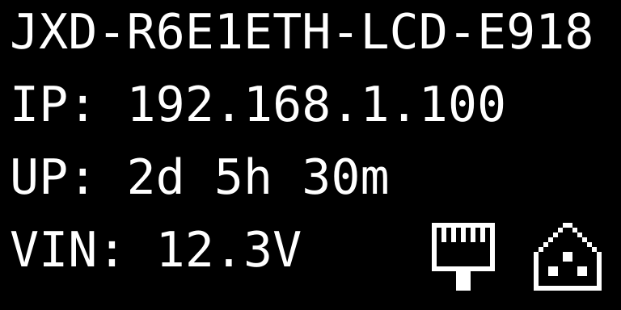

# ESPHome Device Configurations made by JetHome


Open-source ESPHome firmware for the JetHome JXD DIN-rail controllers, to build, change and flash
yourself. For JetHome's proprietary firmware, with more features and support, see the
[JetHome website](https://jethome.com/).

| Device | Config |
| --- | --- |
| **JXD-R6-E1ETH-LCD**, with a 128x64 OLED, a menu and front-panel buttons | `devices/JXD/jxd-r6-e1eth-lcd.yaml` |
| **JXD-R6-E1ETH**, the same controller without the display | `devices/JXD/jxd-r6-e1eth.yaml` |

## Hardware

- ESP32 with 16 MB flash and PSRAM
- 6 relays and 6 digital inputs
- Ethernet (LAN8720) and WiFi
- PCF8563 RTC with battery backup
- Onboard TMP102 and up to 16 Dallas DS18B20 on a 1-Wire bus
- Input voltage measurement
- 2 UARTs for add-on modules; Modbus RTU runs on the RS-485 connector JXM2
- SSD1306/SH1106 128x64 OLED on the LCD variant

## What it does

- **Home Assistant**: native ESPHome API; Home Assistant discovers the device and adds it
  ([Home Assistant](doc/HOME_ASSISTANT.md))
- **Web dashboard** at `http://<device>/`: entities and their settings, automations, thermostats,
  schedules, the log, files and the device settings ([details](components/web_device_dashboard/README.md))
- **Thermostats**: hysteresis or PID control of a relay from any temperature sensor, each a climate
  entity in Home Assistant ([Thermostats](doc/CLIMATE.md))
- **Schedules**: switch points through the week, each starting a mode: a list of relay and
  thermostat actions
  ([Schedules](doc/SCHEDULES.md))
- **Automations**: rules kept on the device and changed without a recompile
  ([Automations](doc/AUTOMATIONS.md))
- **Relay and input settings**: inversion, start mode, an input bound to a relay, labels, and
  virtual inputs with on and off delays ([Entity settings](doc/ENTITY_SETTINGS.md))
- **Dallas sensors**: found at boot, numbered once and kept across reboots, with an offset and a
  label per slot ([1-Wire sensors](doc/ONEWIRE_WORKFLOW.md))
- **Modbus RTU server**: relays, inputs and temperatures for a PLC or SCADA ([map](#modbus-rtu-server))
- **Time**: the RTC set from Home Assistant, NTP or by hand ([Time](doc/TIME.md))
- **Display**: status, clock and a settings menu on the LCD variant ([Display](doc/DISPLAY.md))
- **Firmware updates**: the firmware checks fw.jethome.com for a newer build and installs it on
  request, with a rollback to the previous one ([details](doc/RELEASE.md#updates-on-the-device))
- **Files and crash reports**: a 4 MB user partition, kept across updates and served over HTTP;
  after a crash the device saves a report there ([files](components/web_file_browser/README.md),
  [crash reports](components/crash_report/README.md))

## Getting started

### Build and flash

You need Python 3.12, 3.13 or 3.14 and, for the first flash, a USB cable or a serial adapter. The
setup script installs ESPHome 2026.9.1, the version these configs are pinned to. On Windows run
`scripts\setup.bat`, then `.venv\Scripts\activate`.

```bash
git clone https://github.com/jethome-iot/esphome-device-configs.git
cd esphome-device-configs
./scripts/setup.sh && source .venv/bin/activate
esphome run devices/JXD/jxd-r6-e1eth-lcd.yaml   # first flash, over USB
```

Later builds go over the network while **Allow uploads from ESPHome** is on
([Uploads from ESPHome](doc/HOME_ASSISTANT.md#uploads-from-esphome)). A change to the partition
table, such as the size of the storage partition, still needs USB: OTA keeps the table it finds.

```bash
esphome run devices/JXD/jxd-r6-e1eth-lcd.yaml --device <IP_ADDRESS>
```

The ESPHome Builder add-on imports these configs from `dist/`. A firmware built there is yours to
update: it gets no updates from JetHome.

### First steps

1. **Connect it.** Ethernet works out of the box. For WiFi, switch **Settings → Network** on the
   display or the dashboard to `WiFi` or `Auto`, then give the device your network through its
   access point ([WiFi Setup](doc/WIFI_SETUP.md)).
2. **Add it to Home Assistant within 15 minutes of power-on.** Home Assistant discovers it through
   the ESPHome integration. Missed the window: reboot the device and add it then
   ([Home Assistant](doc/HOME_ASSISTANT.md)).
3. **Change the web password.** The dashboard at `http://<device>/` takes `admin` / `admin` out of
   the factory; set your own under **Settings → Security**.

### Factory reset

**Settings → Factory reset** on the display, **Settings → System** on the dashboard, or the FN
button on the CPU board held for 10 seconds on a running device clears the settings, the WiFi
network, the Home Assistant key and the user partition, and puts the web password back to the
factory one. FN needs neither the display nor the password, so it is the way back from a forgotten
one. After FN the LED blinks fast for 5 seconds before the reset; letting go does not stop it,
cutting the power does.

## Display



The LCD variant boots into the main page: name, address, uptime, input voltage, and the network and
Home Assistant icons. LEFT shows the relays, inputs and temperatures, RIGHT the clock, CENTER opens
the menu, and HOME comes back from anywhere. Every page, the menu and the buttons:
[Display](doc/DISPLAY.md).

## Status LED

The LED on the CPU board is green while all is well. Otherwise it blinks red: a code is that many
blinks and a 2-second pause. Several codes take turns, from the lowest, and after the last a
4-second pause marks where they start again: no network and a due reboot show as 1, 4, 1, 4. The
fast blink of a factory reset shows alone.

| Blinks | Meaning | What to do |
| ------ | ------- | ---------- |
| Fast, nonstop | The FN button was held for 10 seconds: a factory reset in 5 seconds | Letting go of FN does not stop it; only cutting the power within those 5 seconds does |
| 1 | No network for 30 seconds: no address over Ethernet or WiFi | Check the cable or the WiFi network; the code goes once the device has an address |
| 2 | No network for 30 seconds, and the WiFi access point is up to set the device up from | As for 1; to set or change the WiFi network, join that access point ([WiFi Setup](doc/WIFI_SETUP.md)) |
| 3 | A Dallas sensor or PCB Temp has given no readings for a minute, or a running thermostat has lost its sensor's readings | Check the Dallas sensor and its wiring; the code goes at its next reading. For a sensor taken away for good, forget its slot and reboot |
| 4 | A saved change waits for a reboot, such as a temperature slot assigned or forgotten | Reboot the device: **Settings → Reboot device** on the display, or **Reboot now** on the dashboard |

## Modbus RTU Server

The device answers as a Modbus RTU slave on RS-485: address 1 at 9600 8N1 by default. Address, baud
rate, parity and stop bits are set in **Settings → Modbus** on the display or the dashboard, or
through the `Modbus …` entities in Home Assistant, and take effect at once. The dashboard's tab also
shows the map.

| Table | Addresses | Function codes | Content |
| --- | --- | --- | --- |
| Coils | `0x0000`–`0x0005` | `0x01`, `0x05`, `0x0F` | Relays 1–6, read/write |
| Discrete inputs | `0x0010`–`0x0015` | `0x02` | Inputs 1–6 |
| Holding registers | `0x0000`–`0x000F` | `0x03`, `0x04` | Temperatures 1–16, signed, 0.1 °C; `0x8000` = no reading |

Any other register answers `0` instead of an exception. A write that would move a relay a running
thermostat drives answers exception `0x04`; writing the state it already has is accepted, and FC
`0x0F` writes the coils before a refused one.

RS-485 connector JXM2: pins 1 and 3 are B, pins 2 and 4 are A.

## Documentation

Using the device:

- [WiFi Setup](doc/WIFI_SETUP.md): the network mode and the captive portal
- [Home Assistant](doc/HOME_ASSISTANT.md): adding the device, moving it, uploads from ESPHome
- [Display](doc/DISPLAY.md): pages, menu and buttons
- [Time](doc/TIME.md): timezone, NTP and setting the clock
- [Entity Settings](doc/ENTITY_SETTINGS.md): what a relay and an input remember, and virtual inputs
- [OneWire Temperature Sensors](doc/ONEWIRE_WORKFLOW.md): how DS18B20 sensors get their slots
- [Runtime Automations](doc/AUTOMATIONS.md), [Thermostats](doc/CLIMATE.md), [Schedules](doc/SCHEDULES.md)

Working on the firmware:

- [Development](doc/DEVELOPMENT.md): setup, commands, checks and the rules
- [Architecture](doc/ARCHITECTURE.md): how the packages fit together, and what every directory holds
- [Testing](doc/TESTING.md), [QEMU](doc/QEMU.md), [Release Workflow](doc/RELEASE.md),
  [dist/ and new devices](doc/DIST.md)

## Repository Layout

```
devices/JXD/      device configs and their packages
components/       external components
scripts/          generators and tools
tests/            Google Test suites, one per component
doc/              guides
dist/             generated configs the ESPHome Builder imports
assets/           fonts and generated icons
firmwares.yaml    the firmwares CI builds and releases
```

What each directory, package and component holds: [Architecture](doc/ARCHITECTURE.md#layout). The
BDF display fonts in `assets/fonts/` come from [IT-Studio-Rech/bdf-fonts](https://github.com/IT-Studio-Rech/bdf-fonts).

## Contributing

Contributions are welcome. Every change starts as an issue: open one, then a pull request that
says `Closes #N` or `Part of #N`. It targets `dev`, where development happens; `master` is the
source of truth a release is built from, and only the release machinery and the rules go
straight there. Issues, pull requests, commit messages and documentation are in English. The
rules, with the templates in `.github/`, are in [Development](doc/DEVELOPMENT.md) — start there
for the setup and checks too, then [Architecture](doc/ARCHITECTURE.md) for how the packages fit
together and [dist/ and new devices](doc/DIST.md) to add a device.

## License

This project is open-source.

## Related Links

- [ESPHome Official Documentation](https://esphome.io/)
- [JetHome Official Website](https://jethome.com/) - Proprietary firmware version with additional features
- [JetHome AliExpress Store](https://aliexpress.ru/store/1105052969)

## Support

For issues related to:

- **Open-source firmware**: [open an issue](https://github.com/jethome-iot/esphome-device-configs/issues/new/choose) here — a bug report or a feature request
- **Hardware or proprietary firmware**: Contact [JetHome support](mailto:sales@jethome.com)
