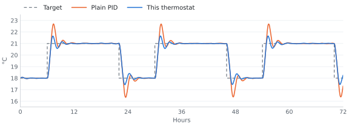
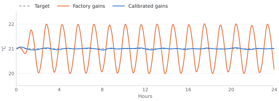
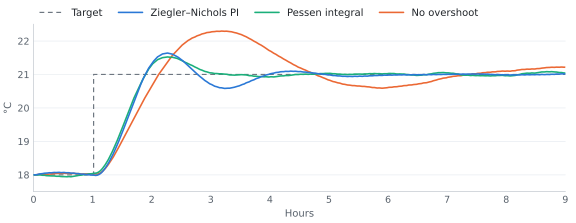
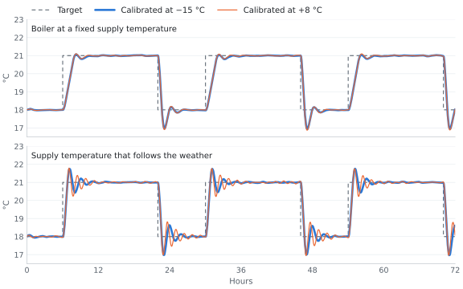

# Thermostats

Thermostats the device runs without a recompile. Each one reads a temperature sensor in °C — a
`Temp N` probe, say — and switches a heating relay, a cooling relay or both, with a hysteresis
(bang-bang) or a PID control law. Each running thermostat is a climate entity: Home Assistant
and the web server show it and set its mode and target like any other. Thermostats are
created, changed, started, stopped and removed while the device runs, over HTTP under
`/climate-editor/api` or from a lambda; a file written into their folder by hand is picked up
at the next boot. The file format and the C++ API are in
[components/climate_hub/README.md](../components/climate_hub/README.md).

## What a thermostat does

- **Hysteresis**: heats below the target minus a band and stops above the target plus a band,
  or cools the other way round. **PID**: drives the relay as a slow PWM, from 0 to 100 % of a
  period of minutes; time spent in mode off, on a fault that stops it or waiting for a reading
  adds nothing to what it has learnt, and neither does a stretch with the relay fully on or
  fully off, so a step in the target, a night setback or its end, does not carry the room a
  degree or two past the new one. Each relay has its own gains: in heat the PID runs on the
  heating relay's, in cool on the cooling relay's. Switched from one to the other it starts
  afresh on the other relay's gains; mode off in between keeps what it learnt for the relay it
  comes back to.

  

  A plain PID, which goes on learning while the relay is fully on or off, carries the room 1.7 °C
  past each new target of a night setback; this thermostat about 0.6 °C. In a modelled room with
  radiators.
- **Modes**: off, heat or cool, as far as its relays allow. A thermostat with both a heating
  and a cooling relay runs one of them at a time, and is switched between heat and cool by
  hand, a preset, a rule or a schedule. Switched straight from one to the other, the new relay
  closes only once the other has opened, which that relay's minimum on time may hold off: the
  two never run at once, with two exceptions. A relay switched on from elsewhere in the
  meantime stays on until it is put back, as below. And a thermostat that takes over a heating
  and a cooling relay from two thermostats that were running them at once keeps both closed
  until the one its mode does not drive has had its minimum on time.
- **Presets**: up to eight per thermostat, each a name, a target and a mode or "keep the
  current one". Picking one, from Home Assistant, the web server, the editor's API or the
  panel, sets its target and its mode; a stopped thermostat keeps the pick and starts in it. A
  target or a mode set by hand afterwards keeps it shown as the active preset.
  Editing the active preset's values applies them at once, and the active preset comes back
  after a reboot.
- **Automation rules** can turn a thermostat off and back on, in the mode it was in before it
  went off, pick one of its presets or set its target, or follow an input or a switch with a
  preset or on/off ([Automations](AUTOMATIONS.md)). The mode to go back to is kept across a
  reboot, and a thermostat restored from a backup goes back to the backup's.
- **Schedules** turn a thermostat on or off, pick one of its presets or set its target by the
  time of day and the day of the week, among the other actions of a mode; a preset or a target
  turns a thermostat that is off back on ([Schedules](SCHEDULES.md)).
- **Safety**: it keeps its relays open until its sensor's first reading, and waits for one
  as long as the sensor timeout before it reports a fault. A sensor silent for longer than its
  timeout, or a reading above the cut-out temperature, opens the relays until that clears. A
  thermostat that starts on a sensor that has fallen silent shows its last value but does not
  act on it. A reading that is not a number, or an infinite one, counts as no reading at all.
- **Relay wear**: a minimum on and off time, 10 s each unless set otherwise, counted from the
  relay's last move, whichever thermostat made it. A thermostat shows what its relays do, not
  what it wants: idle until a relay held open by its minimum off time closes, heating until one
  held closed by its minimum on time opens, and over HTTP its status says which minimum it waits
  on, or that it waits for the other relay to open. Saving a thermostat does not restart its
  cycle, and a PID keeps what it has learnt unless the Save changes its control law or its
  sensor; new gains for the relay it runs on apply from its next pass.
- **A relay belongs to the running thermostat**, in mode off too, which keeps it open; only
  stopping the thermostat frees it. What the rest of the device does with such a relay is
  below. Two thermostats may name one relay and take turns, a summer and a winter profile on
  one boiler; only one of them is switched on at a time, and taking the relay over from the
  other switches the other off and leaves the relay as it is. One that could not run, its
  sensor or a relay missing, cannot take it over.

## Calibrating a PID thermostat

A PID thermostat can find its own gains. A calibration, started from the editor or over HTTP,
swings the room around its target: the relay closes fully once the room is a quarter of a degree under the
target and opens a quarter of a degree over it, so the room goes about half a degree to a degree
either side, more where the heat is slow to arrive. The relay's minimum on and off times and the
cut-out temperature hold throughout. A room with radiators takes about an hour and a half, a
floor heating eight to ten hours. Start it with the room near its target: a cold floor heats at
full power until it reaches the band, and one that needs more than 6 hours for that ends the
calibration before its first swing. It swings the relay of the current mode, the heating one in
heat and the cooling one in cool, and the other one stays open; a thermostat with both relays is
calibrated once in each mode. Home Assistant sees the thermostat heating (cooling when it
calibrates a cooling relay) while the relay is closed, and idle otherwise.

The device then turns what it measured into the gains of the rule picked at the start
(Ziegler-Nichols PI unless another), writes them into the thermostat as that relay's gains, the
other relay keeping its own, and runs with them. An
editor page opened before can no longer save over them: its Save is refused until it reloads, as
it is after a thermostat was brought back from a backup over the one it shows.
The result, the gains it replaced and any warning about it stay in the thermostat's status until
the next calibration, a delete or a reboot, and the result is kept for good as a
[saved gain set](#saved-gain-sets).



The factory gains swing the room a degree either side of the target; calibrated ones hold it
within a tenth. In a modelled room with radiators.

A calibration ends without new gains when it is cancelled, when the target or the mode changes
from anywhere (Home Assistant, the web server, the editor, a rule, a schedule, a preset), when
the thermostat is saved, brought back from a backup, switched off, deleted or taken over, on any
fault, after 24 hours, after 6 hours without a relay switch (a heater that cannot cross the
band), or when a noisy probe crosses the target more than 65 times. A reboot ends it too. The
status says which, and the thermostat goes back to its PID with the gains it had.

### Which rule to pick

| Heating | Rule |
| --- | --- |
| Radiators, a floor heating or a convector sized for the room, or not sure | Ziegler–Nichols PI, the default |
| A heater far larger than the room needs, on a sixth of the time or less once the room is warm | Ziegler–Nichols PID or Pessen integral if the relay may switch about a third more often, Ziegler–Nichols PI otherwise |
| A heater that only just keeps the room warm in the cold | Pessen integral |



After a step from 18 to 21 °C, No overshoot gets there last and overshoots most, 1.3 °C against
Ziegler–Nichols PI's 0.6 °C; Pessen integral settles first. In a modelled room with radiators.

What simulated rooms showed:

- With radiators, floors and convectors sized for the room, no rule held the target more than
  about a tenth better than Ziegler–Nichols PI. The rules with a derivative term, Ziegler–Nichols
  PID and Pessen integral, switched the relay a fifth to a third more often with radiators, and
  twice as often on a floor, where they did worse.
- A heater far larger than the room needs overshot by about a degree on Ziegler–Nichols PI, by
  half that on Ziegler–Nichols PID or Pessen integral.
- With a heater that only just keeps up, Pessen integral brought the room to the target in
  two-thirds of Ziegler–Nichols PI's time after a start or a calibration, and did as well after a
  change of target.
- Some overshoot and No overshoot take longest to settle, and in most rooms they overshot more
  than Ziegler–Nichols PI, not less.
- Calibrate rather than keep the default gains: those keep most rooms swinging around the target.
- Calibrate with the room near its target, and a floor heating in mild weather: on a cold day it
  runs most of the time just to keep up, so the room may not cross the band in 6 hours, and the
  calibration ends with `no_switch`.
- Right after a calibration the PID starts over, so the room dips up to two degrees below the
  target, more with a heater that only just keeps up. It is back at the target within an hour to
  a few with radiators, five to nine hours with a floor heating.
- A probe whose readings jitter by more than about 0.1 °C spoils the gains while the calibration
  still succeeds: they come out far too sharp and the room swings. A DS18B20 read every 20 s is
  fine. When the result warns `uneven`, calibrate again, or apply the gain set an earlier
  calibration saved.
- Keep the relay's minimum on and off times under about a fifth of the PWM period (300 s by
  default): longer ones keep the relay from delivering the heat the PID asks for, and the room
  settles late or never.
- Gains calibrated in mild weather hold the room as well in the cold, so one calibration does for
  the year, unless the boiler's supply temperature follows the weather. Then a calibration in
  each season, each kept as a gain set, can be applied when the season turns.



At −15 °C outside, gains calibrated at +8 °C do as well as those calibrated in the cold, unless
the supply temperature follows the weather. In a modelled room with radiators.

## Saved gain sets

Every calibration that succeeds is kept as a gain set of its thermostat: the gains it wrote, the
rule, what it measured and its warnings, named after the date and time it ended and the rule
(`2026-10-26 14:05 ZN PI`), or, while the device's clock is not set, after the relay, the rule
and a number (`Heat ZN PI #3`). A thermostat keeps as many as the storage has room for. From the
editor:

- **Save the gains a relay has now** as a set, the ones typed in by hand among them, to come back
  to after trying others.
- **Apply a set**: its gains become those of its relay, the other relay keeping its own. A
  running PID goes on with them at once and keeps what it had learnt. An editor page opened
  before has to reload before it can save. Not while the thermostat calibrates.
- **Another rule for the same measurement**: a calibration's set keeps the room's Ku and Pu, so
  the gains of another rule come from them without calibrating again, as a new set that says
  which one it came from, applied at once if asked.
- **Rename** a set, up to 48 characters in any script, or **delete** it. Two sets may share a
  name; a deleted set's number is never given to another.

A season can keep its own set: one calibrated in winter and one in spring, say, applied as the
weather turns. With less than 64 KiB free on the storage no new set is saved; a calibration then
still writes its gains into the thermostat, and its result says that no set was saved.

## A running thermostat's relays

What everything else that switches a relay does with one a running thermostat drives:

| Writer | On a relay a running thermostat drives |
| --- | --- |
| The panel: CENTER on the status page, **Relays → Relay N → State** | leave it alone; the log names the thermostat |
| Modbus coils `0x0000`–`0x0005` | a write that would move it answers exception `0x04`; writing the state it already has is accepted |
| Automation rules, `switch` actions | leave it alone and log the rule and the thermostat; the rest of the rule runs |
| Input bindings, Toggle and Follow | leave it alone; once the thermostat frees it, a Follow relay takes its input's state at once, unless a thermostat that waited for the relay starts on it |
| Schedules | skip the action, and the schedule's status lists it with the thermostat's name; once the thermostat frees it, the relay takes the last action on it the list of the mode in force has passed |
| Home Assistant, the web server's REST | switch it, and the thermostat puts it back, as below; the dashboard locks its own toggle |
| **Inverted** in the relay's settings, on the panel or the dashboard | refused; the dashboard's answer and the panel's log name the thermostat. Start mode and the binding change as usual |

**Switched from elsewhere.** A relay switched by Home Assistant or the REST API is put back
within a moment. Switched again, it stays there for its minimum on or off time, 10 s at least,
before it is put back, so whatever keeps switching it cannot make it chatter. Once five
switches come without ten quiet minutes after a put-back between them, the thermostat reports
`relay_contested`: it goes on working, and the fault clears ten minutes after the last
put-back. Until the sensor's first reading, while it is silent or while the room is above the
cut-out temperature, a relay switched on from elsewhere is switched off again at once, every
time.

**The boot pulse.** A relay whose Start mode is On, or Last when it was on, closes when the
device starts, before any thermostat runs, and stays closed until the thermostat that drives it
takes it over at its first pass, a moment later; an input binding does not move it in between.
Start mode Off on that relay avoids the pulse.

## Storage

Thermostats are `/littlefs/climates/<id>.json` on the LittleFS partition from
`features/storage.yaml`, one file per thermostat, `id` made from the name when it was created.
The device keeps at most eight. OTA updates keep the files; a factory reset formats the
partition, so the thermostats go with it. A file dropped into the folder, over the file API
under `/files` for instance, is loaded at the next boot.

Each thermostat's gain sets are `/littlefs/climates/gains/<id>.jsonl`, one set per line.
Deleting the thermostat deletes them, and a new thermostat that gets the id of one deleted before
starts with none. The dashboard's Backup takes the folder with the thermostats, and its Restore
writes the sets back before it brings the thermostat back, so they return together. A file the
boot does not load keeps its sets beside it.

A file written by a newer firmware, after a rollback say, loads and runs as far as this one
understands it, but this firmware never writes it: a change from Home Assistant, the panel or a
rule lasts until the next reboot, and a Save from the editor is refused with a sentence that
says a newer firmware wrote it. Starting it in another thermostat's place lasts until the next
reboot too: the ones it took the relay from, running or waiting, stay enabled in their files.
Deleting the thermostat still works. To a firmware from before each relay had its own gains,
2026.9.1.0 among them, every thermostat file this one writes is a newer firmware's, calibrated
or not: rolled back to it, every thermostat saved or changed here keeps running, on the gains of
the relay it turns on in, but cannot be changed for good until this firmware is back. A
calibrated one runs its gains as far as a firmware from before calibration allows, and its file
keeps them for the next update. A newer file that breaks this firmware's rules — a preset mode it
does not know, more than eight presets, a control law it does not have — is not loaded and is
left as it is, as any file that breaks them.

A file from an older firmware gives its one set of gains to both relays. One that names the
heat and cool mode those firmwares had, as its mode, as the mode to go back to or in a preset, is
not loaded and is left as it is: the thermostat has to be made again, in heat or in cool. Until
then the file keeps its id: the thermostat is not in the list and cannot be deleted from the
editor, a new one with the same name gets the id with `-2` after it, an import under the old id
is refused, and rules and schedules that name it find no thermostat. To use the id again,
delete the file: `climates/<id>.json` on the dashboard's Files screen, or `POST /files/delete`
with `path=/climates/<id>.json`. The id is free at once, with no reboot: a thermostat made again
with the same name, or imported from a backup, takes it, and the rules and schedules find it
again.

A thermostat whose sensor or relay is missing, at boot or when it is saved or switched on, stays
enabled on disk but does not run; the Save or the switch-on succeeds with a warning that names
what is missing. It starts at the next boot that finds what it names, or at a Save or a
switch-on that finds it there. Until then, or until it is switched off, the device's log says
why it waits: when the start fails, and again in the configuration it prints whenever a log
viewer connects. Over HTTP, the list and the status say it in their `waiting` field, in the
words of the warning. The device's own settings, such as **Allow uploads from ESPHome**, are never
a relay and count as missing.

Two thermostats switched on for one relay come only from files written by hand or a restore.
The boot runs the first by id, and the other waits for the relay: it starts as soon as the
first is switched off, removed or saved onto another relay, and the answer to that change names
it.

## Over HTTP

`features/climate-editor.yaml` serves the thermostats on the web server port under
`/climate-editor/api`: list them, read, create, change and delete one, bring one back from a
backup under its own id with its presets as they were, edit and pick its presets, start or stop
it, move its target, calibrate it, keep, apply and derive its gain sets, and watch what each one
is doing and which preset is active.
The routes and their contract are in
[components/web_climate_editor/openapi.yaml](../components/web_climate_editor/openapi.yaml),
the usage in [its README](../components/web_climate_editor/README.md).

A Save or a start over `enable` of a thermostat that is to run is refused while another
thermostat that is switched on names its relay, running or waiting, or when its sensor does not
report °C; one whose sensor or relay is missing is stored enabled and waits, as above. A start
can take the relay over instead of being refused, which stores the other thermostats on it as
disabled and stops the one that runs; one whose sensor or relay is missing cannot.

## On the display

**Thermostats** in the display menu of `jxd-r6-e1eth-lcd` lists the thermostats the device
booted with, each with what its sensor reads; one created later shows after a reboot. A row
opens its name, the reading, what it is doing (Heating, Cooling, Idle, Off, Waiting, Disabled,
or in a word the fault that keeps it from controlling), the target, the preset and Enabled. The
target moves in the thermostat's own step inside its range. Preset shows the active preset, `--`
for none, and steps through the thermostat's presets in their order, through `--` too when none
was active; closed after a step, it picks the preset shown, the active one included, which brings
back its values after a target or mode set by hand. It does not open on a thermostat without
presets, and a pick that fails leaves the active preset, the log saying why. Enabled starts or
stops it like the start over HTTP, never taking a relay over: an On that is refused stays Off,
and the log says why.

## Home Assistant

- Home Assistant knows an entity by an id it makes from the name (see below), so **renaming a
  thermostat makes a new entity there** and Home Assistant removes the old one: what names it
  there (automations, scripts, dashboards) has to be pointed at the new one, what was set for it
  there (name, icon, area) does not follow, and its history stays under the old entity id. A
  rename between two names that give the same id, `Кухня` to `Ванна` say, keeps the entity. A
  thermostat that stops, or that a boot leaves waiting, is removed there the same way; whenever
  one runs again under a name that gives that id, it comes back as the same entity, with what was
  set for it in Home Assistant, and so does a new thermostat whose name gives the id of one
  removed.
- Home Assistant reconnects to see the change when a thermostat starts or stops (removing a
  running one stops it), and when a running one is renamed, gains or loses its heating or
  cooling relay, gets a new temperature range or step, gains or loses one of Home Assistant's
  own presets, or has one of its other presets added, removed, renamed or moved: the whole
  device shows as unavailable for about five seconds, and a log stream over the API drops and
  reconnects. Swapping one relay for another, a new target, mode, band or gains, new values for
  a preset, one of Home Assistant's own presets written in another case (`Eco` as `ECO`) or
  moved in the list, and any change to a thermostat that is not running never do this.
- A preset named like one of Home Assistant's own (eco, away, boost, comfort, home, sleep,
  activity, in any case) is that preset there, translated in its interface; any other name is
  shown as it is. `none` is Home Assistant's word for no preset and cannot be a name.
- A name may be in any script. Names are unique on the device: two thermostats cannot share one,
  nor two names that give the same entity id (`Room 1` and `Room_1`), nor a thermostat and a
  climate from the YAML. Home Assistant tells entities apart by an id that keeps only the name's
  Latin letters, digits, `-` and `_`, every other character one `_`, a space and punctuation
  too, so `Кухня` and `Ванна` clash; a digit or a Latin letter tells them apart (`Кухня 1`,
  `Ванна 2`).
- The room temperature is shown to a tenth of a degree; the target moves in the thermostat's
  own step.
- A running thermostat shows as heating or cooling while that relay is closed, a PID also
  between two of its pulses, and as idle otherwise: it turns heating only once the relay's
  minimum off time lets it close. Off means mode off, a fault other than `relay_contested`, or
  a thermostat that is not running.

## Testing without hardware

```bash
python tests/run.py climate_hub [-- --gtest_filter='ControlLoop.*']
python tests/run.py web_climate_editor
```

Builds the component for the host platform into a Google Test binary: the control laws, the
relay timing, the file format, and the whole component over a directory that stands in for the
flash, with a clock the test moves. The second suite drives every HTTP route through the
handler, over the real component and a stand-in for the web server. In the emulator,
`packages/qemu/climate-plant.yaml` adds a `QEMU Room Temperature` sensor that `Relay 1` warms,
so a thermostat has a room to control ([QEMU](QEMU.md)). Before a pull request, the
[smoke check](QEMU.md#the-thermostat-smoke-check) runs one there over the native API.
