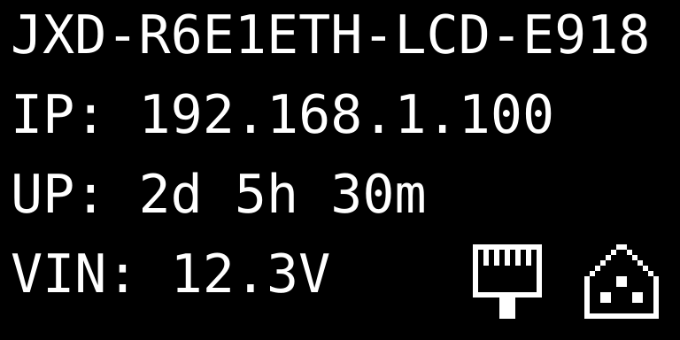
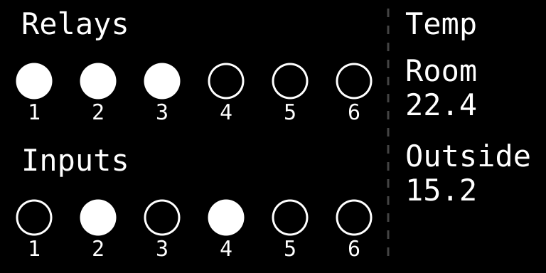
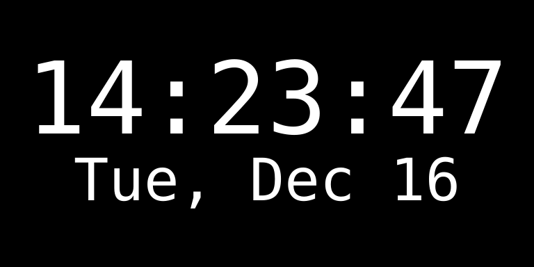
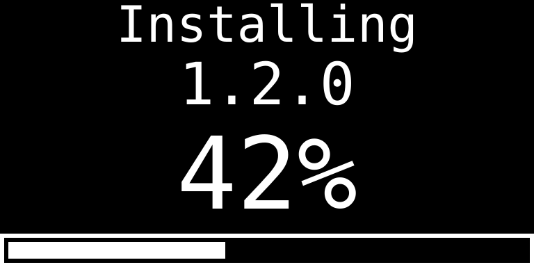

# Display

The JXD-R6-E1ETH-LCD's 128x64 screen: five pages and a menu. The main page is what you get at
boot and after HOME; everything else is one button away from it, except the firmware install
page, which the device puts up on its own.

## Buttons

| Button      | Effect |
| ----------- | ------ |
| `HOME`      | Main page, from anywhere |
| `BACK`      | Main page; from the main page blanks the screen; in the menu goes up one level, then exits |
| `LEFT`      | Main page → status page; on the status page selects the previous relay; adjusts menu values |
| `RIGHT`     | Main page → time page; on the status page selects the next relay; adjusts menu values |
| `CENTER`    | Main page → menu; on the status page toggles the selected relay; in the menu enters |
| `UP` `DOWN` | Move through the menu; on the status page scroll the temperatures |

## Main page

Device name, IP address, uptime and input voltage. The two icons in the bottom-right corner are
the link (Ethernet or WiFi, whichever carries the traffic) and the Home Assistant connection;
a crossed-out icon means that connection is down. While the WiFi setup access point is up and no
link carries traffic, the WiFi icon is shown and the address is the access point's.

## Status page

LEFT from the main page. Relay states, input states and temperatures, each slot by its label when
it has one. LEFT and RIGHT move along the relay row, the selected number drawn inverted, and
CENTER toggles that relay. UP and DOWN scroll the temperatures. A relay a running thermostat
drives does not toggle; the log names the thermostat.

## Time page

RIGHT from the main page. Date and time from the RTC.

## Firmware install page

Up while a firmware image is being written, whatever started the install — the menu, Home
Assistant or the dashboard: the version being installed, the percentage and a progress bar. The
screen does not blank meanwhile, and the device reboots into the new firmware as soon as the image
is in. A failed install says so and leaves the running firmware in place; any button, or half a
minute, takes the page away.

## Blank screen

The screen blanks on BACK from the main page, or after **Settings → Display off** (5, 10 or 15
minutes, or never) without a press. Any button wakes it: LEFT onto the status page, RIGHT onto the
time page, anything else onto the main page.

## Menu

CENTER from the main page. CENTER opens a setting, LEFT and RIGHT pick its value, and the device
applies it when CENTER or BACK closes the row, or when you leave the menu with the row open.

- **Relays** — a submenu per relay: State, Inverted, Start mode, Bind to, Binding
  ([Entity settings](ENTITY_SETTINGS.md#display-menu))
- **Inputs** — a submenu per input: live state and Inverted
- **Temperatures** — the readings, each slot by its label when it has one; a DS18B20 row opens its
  slot: label or name, `Slot N`, reading, ROM address, offset and a forget command
  ([1-Wire sensors](ONEWIRE_WORKFLOW.md))
- **Automations** — a row per rule that switches it on or off
- **Thermostats** — a row per thermostat with its sensor's reading; it opens the name, the
  reading, what it is doing (heating, idle, waiting, a fault), the target, the preset and Enabled
- **Schedules** — a row per schedule with whether it is on; it opens the name, the state, the
  mode in force, the next mode and when it comes, and Enabled ([Schedules](SCHEDULES.md#on-the-display))
- **Info** — Ethernet and WiFi addresses and MACs, the access point password, the timezone in
  effect (the city of a zone chosen on the dashboard, else its offset, as `UTC+3`) and the serial
  number (`--` when the board holds none)
- **Settings** — below

Automations, Thermostats and Schedules list what the device booted with: one created later shows
after a reboot.

### Settings

- **Display off** — the blanking timeout
- **Network** — `Ethernet`, `WiFi` or `Auto` ([Network mode](WIFI_SETUP.md#network-mode))
- **ESPHome OTA** — the **Allow uploads from ESPHome** switch
  ([Uploads from ESPHome](HOME_ASSISTANT.md#uploads-from-esphome))
- **Modbus** — address, baud rate, parity and stop bits ([Modbus](MODBUS.md))
- **Firmware** — the running and the offered version, the channel, a check, an install, and a
  rollback row that says whether there is a firmware to go back to; after a rollback the same row
  goes forward again ([updates](RELEASE.md#updates-on-the-device))
- **Temp sensors** — forgets every temperature slot
- **Forget HA** — clears the Home Assistant key and reboots
  ([Home Assistant](HOME_ASSISTANT.md#moving-to-another-home-assistant))
- **Reset WiFi creds** — clears the stored WiFi network
- **Reboot device**
- **Factory reset** — clears the settings, the WiFi network, the Home Assistant key and the user
  partition ([Factory reset](../README.md#factory-reset))
